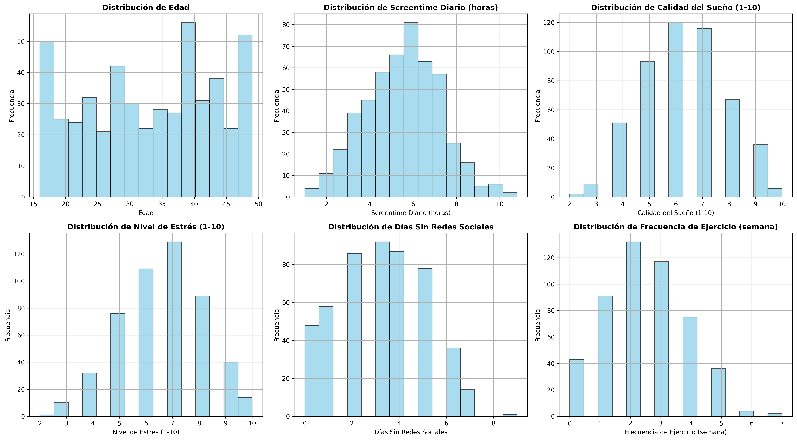

# Hábitos digitales y bienestar

Trabajo final de **Aprendizaje Automático II** (Grado en Ciencia de Datos e IA, curso 2025–2026). Predice el índice de felicidad (`Happiness_Index(1-10)`) a partir de hábitos digitales y variables de bienestar.

**Autoría.** El análisis exploratorio y el primer modelo con Random Forest son individuales. El informe final, que compara modelos y optimiza Gradient Boosting, se hizo en pareja con una compañera. El informe no se incluye en el repositorio.

## Datos

*Mental Health and Social Media Balance Dataset*: 500 filas y 10 columnas con edad, género, tiempo de pantalla, calidad del sueño, estrés, días sin redes, ejercicio, plataforma e índice de felicidad. El CSV **no se incluye** porque no hay una licencia de redistribución verificada. Para ejecutar el código, consigue el archivo y colócalo en `data/Mental_Health_and_Social_Media_Balance_Dataset.csv`, dentro de esta carpeta, o pásalo con `--data`.

## Contenido

| Archivo | Qué hace |
| --- | --- |
| `analisis_exploratorio.ipynb` | Análisis exploratorio: distribuciones, correlaciones, comparación por plataforma, género y edad, ANOVA y Random Forest |
| `codigo_proyecto_redes_salud_mental.py` | Primera fase: preparación de datos, figuras y Random Forest de 200 árboles con partición 80/20 y semilla 42 |
| `codigo_proyecto_final_salud_mental.py` | Versión final: Random Forest frente a Gradient Boosting, variables categóricas con `ColumnTransformer` y `OneHotEncoder`, y `GridSearchCV` (192 combinaciones, cinco particiones, R²) |
| `figures/` | Seis figuras del análisis exploratorio generadas por el código |

## Resultados

| Modelo | RMSE | R² |
| --- | --- | --- |
| Random Forest | 0.936 | 0.631 |
| Gradient Boosting básico | 0.929 | 0.637 |
| Gradient Boosting optimizado | **0.903** | **0.656** |

Mejor configuración: `learning_rate=0.01`, `max_depth=2`, `n_estimators=300`, `subsample=0.8`. El estrés (−0.737), el tiempo de pantalla (−0.705) y el sueño (+0.679) son las variables más asociadas con la felicidad. Son asociaciones dentro de la muestra, no relaciones causales. Las métricas corresponden a una única partición de prueba, sin intervalos de incertidumbre. Las correlaciones son de Pearson; con estas variables habría sido más adecuado Spearman.



## Ejecutar

Desde la raíz del repositorio, después de instalar `requirements.txt`:

```sh
python digital-habits-wellbeing/codigo_proyecto_redes_salud_mental.py --data ruta/al/dataset.csv --output-dir resultados
python digital-habits-wellbeing/codigo_proyecto_final_salud_mental.py --data ruta/al/dataset.csv
```

El primer script guarda tablas y figuras. El segundo evalúa la rejilla completa (960 ajustes) y tarda unos minutos.
